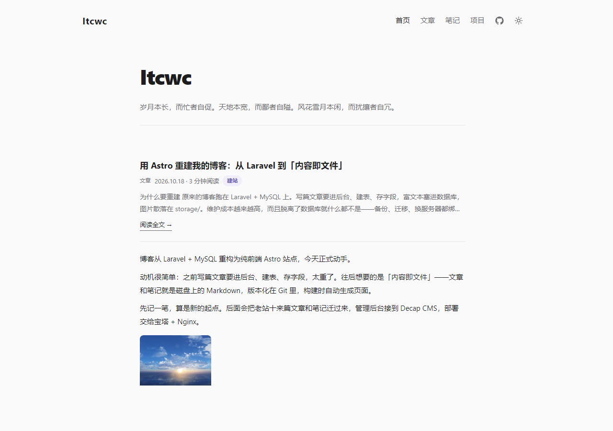
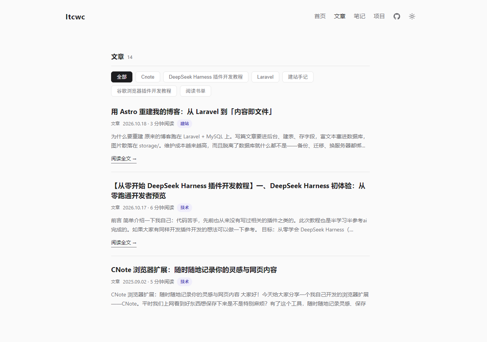
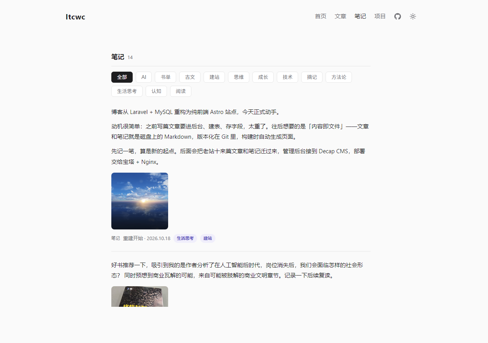
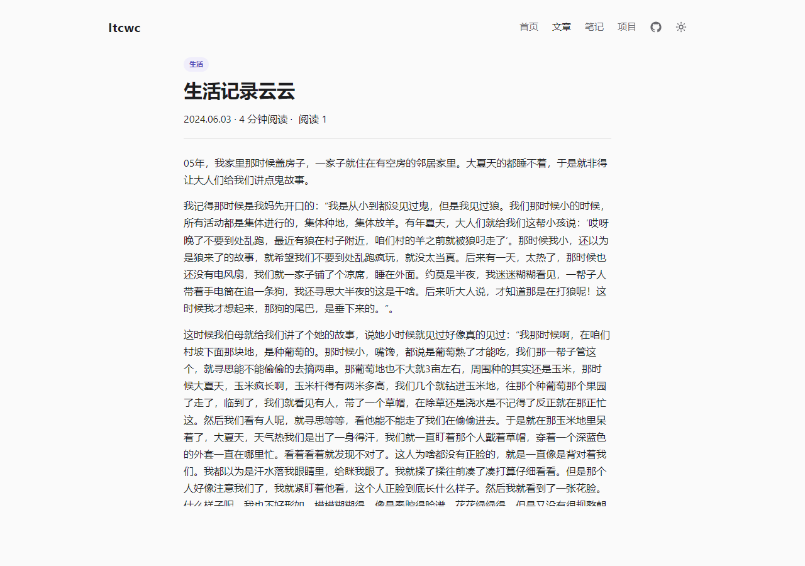
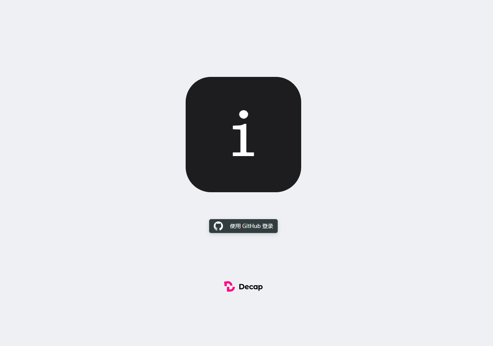

<div align="center">

# Cards Blog

**A minimal cards-style static blog template · Astro 5 · Content as files · No database, no server**

[](LICENSE)
[](https://astro.build)
[]()

[简体中文](README.md) | **English**

</div>

A minimal blog template built with **Astro 5**. Posts and notes are plain Markdown files in the repo; the build output is pure static HTML you can drop onto Nginx, object storage, or any static hosting platform. No database, no runtime service, no backend to maintain.

An optional **Decap CMS admin panel** lives at `/webadm/` — sign in with GitHub OAuth and every save is committed straight to the repository, which makes it handy for jotting things down from a phone.

## Screenshots

| Home (posts + notes mixed) | Posts (series filter + pagination) |
| --- | --- |
|  |  |

| Notes (tag filter + pagination) | Post detail | Admin sign-in |
| --- | --- | --- |
|  |  |  |

## Features

- **Content as files** — `src/content/articles/*.md` and `src/content/notes/*.md`, versioned by git, editable in any editor
- **Type-safe content model** — Astro Content Collections with a zod schema, so a broken frontmatter fails at build time
- **Cards-style layout** — posts and notes interleaved by date on the home page, magazine-style cards with category chips and a left accent bar for notes
- **Filtering and pagination** — series/tag filters plus client-side pagination (9 per page on list pages, 12 on the home feed), all without a backend
- **Series (column) pages** — the `series` field automatically archives entries to `/columns/<series-name>`
- **Drafts** — anything with `draft: true` is filtered out at build time and never appears on the site
- **Optional online admin** — Decap CMS with GitHub OAuth (self-hosted authorization endpoint on Cloudflare Workers); saving commits to the repo
- **Theming and i18n scaffolding** — light/dark theme toggle, Simplified Chinese UI
- **Built-in niceties** — reading time, date formatting, note galleries

## Quick start

```bash
pnpm install
pnpm dev        # http://localhost:4321
pnpm build      # output in dist/
pnpm preview    # preview the build output locally
```

> Requires Node 18.17+ or 20.3+. npm works too: `npm install && npm run dev`.

## Content

### Layout

```
src/content/
├── articles/   # long-form: tutorials, technical write-ups
└── notes/      # short notes: a line, an image, a quote
```

### Post frontmatter

```yaml
---
title: Post title              # required
date: 2026-10-01               # required
description: A short summary   # optional, used in lists and for SEO
category: Tech                 # optional
series: Getting Started        # optional, archived to /columns/<series>
draft: false                   # true hides it from every page
---
```

### Note frontmatter

```yaml
---
date: 2026-10-01               # required
title: Note title              # optional; when empty the list shows an excerpt
tags: [Astro, Tips]            # optional
images:                        # optional gallery
  - /uploads/xxx.jpg
draft: false
---
```

## Site configuration

Site name, tagline, GitHub link and friends live in **`src/site-config.json`**:

```json
{
  "siteName": "Cards Blog",
  "tagline": "Cards layout · Static first · Content as files",
  "logo": "",
  "icon": "/favicon.svg",
  "github": "https://github.com/your-name/your-repo",
  "footerText": ""
}
```

Rebuild after editing. When you change the domain, also update `site` in `astro.config.mjs`.

## Online admin (optional)

The admin panel lives at **`/webadm/`**. It is powered by [Decap CMS](https://decapcms.org/): sign in with your GitHub account and it commits Markdown directly to the repository — no self-hosted backend service required.

Authorization needs a one-time setup (3 steps); the full notes are in the comments of
[`public/webadm/config.yml`](public/webadm/config.yml):

1. **Deploy the OAuth client** — run [sveltia/sveltia-cms-auth](https://github.com/sveltia/sveltia-cms-auth) on Cloudflare Workers (single file, zero dependencies)
2. **GitHub OAuth App** — set the Authorization callback URL to `<your-worker-url>/callback`
3. **Edit `public/webadm/config.yml`** — replace `repo`, `base_url` and `site_domain`

> ⚠️ Do not set `base_url` to `https://github.com`. GitHub does not support client-side PKCE
> authorization for single-page apps, so the `github` backend must go through an OAuth client;
> hitting GitHub directly produces a 404 because the parameters are not recognized.

## Deployment

### Any static host

Run `pnpm build` and upload `dist/`. Works with Nginx, BT panel (BaoTa), object storage, Vercel, Netlify, Cloudflare Pages, and so on.

### Self-hosting with auto deploy (optional)

The repo ships [`deploy.sh`](deploy.sh), which turns "push to deploy" into a Git WebHook:
fast-forward pull → install dependencies → build → automatic rollback on failure.
See the comments at the top of the script for usage.

## Project structure

```
.
├── astro.config.mjs          # Astro config (static output)
├── deploy.sh                 # self-hosted auto deploy script (optional)
├── public/
│   ├── favicon.svg
│   ├── uploads/              # images uploaded from the admin panel
│   └── webadm/               # Decap CMS entry point
├── src/
│   ├── components/           # cards, header, footer, ...
│   ├── content/              # ← your posts and notes
│   ├── content.config.ts     # content collection schema
│   ├── layouts/
│   ├── lib/                  # site config, reading time, ...
│   ├── pages/                # routes: home / posts / notes / series
│   ├── site-config.json      # ← site name, tagline, GitHub link
│   └── styles/global.css
└── tsconfig.json
```

## License

[MIT](LICENSE)
